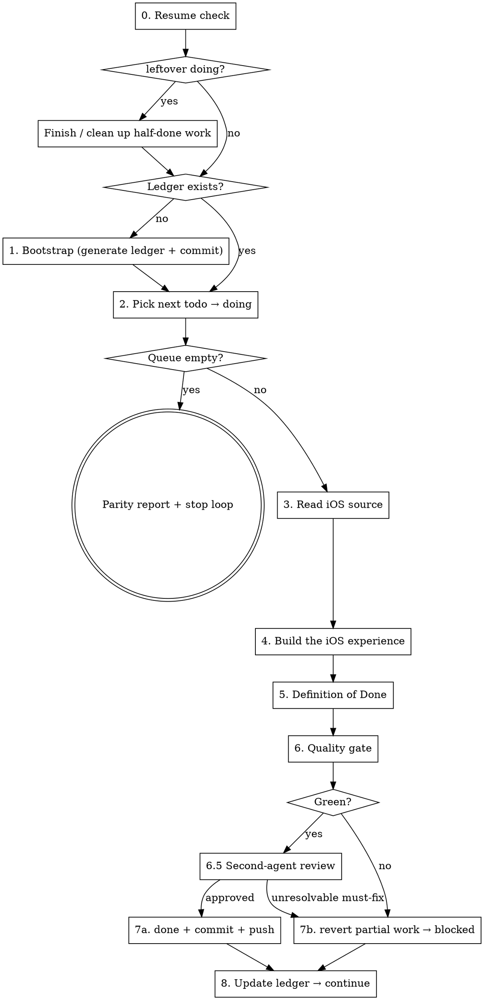

# ios-port — iOS → Android parity autopilot

## Core principle

Bring every user-facing feature of the iOS app (`IOS_REPO` in `tools/port/port.env`) to Android **with the same experience** — design, behavior, usability; differences only where the platform forbids. iOS is the specification, not a Material 3 reinterpretation (`.claude/rules/ios-parity.md` — mandatory). **One invocation = one task.** Every task: read iOS → build the iOS experience → quality gate → commit + push → update ledger. The ledger is the single source of truth; each invocation finds its place there → idempotent, resume-friendly.

Built to be driven by `/loop /ios-port`: it keeps going, and when Claude hits a usage limit /loop waits and continues.

Configuration (paths, gate command, push target) lives in `tools/port/port.env`; every script reads it. Read it once at the start of a session. Shell snippets below use its variables (`$IOS_REPO`, `$IOS_SRC`, `$PUSH_BRANCH`…) — the Bash tool doesn't keep them between calls, so start such a command with `. tools/port/port.env && …`.

## When to use / not

**Use:** iOS→Android port work; the parity loop; "port X from iOS"; resuming an interrupted port.
**Don't:** a one-off unrelated bug fix; a new Android feature that iOS doesn't have (brainstorm first); a pure refactor.

## Directed mode — when the owner names something

Trigger: `/ios-port <request>` or in chat "port X", "make X like iOS", "X differs on Android". **The request picks the task, not the queue;** only step 2 of the flow changes, the rest (3–7) applies unchanged.

1. **Find it on iOS.** `bash tools/port/ios_ref.sh` (if the branch is wrong, stop and tell the owner). Map the request to Swift source: `find "$IOS_REPO/$IOS_SRC" -iname '*X*'`, `bash tools/port/ios_cite.sh <View>`; if on-screen text was given, `grep -rn '<text>' "$IOS_REPO/$IOS_LOCALIZATION"` → key → the View that uses it. Several candidates → list them with file paths and ask **one** question; don't guess. Not on iOS → it is not a port: stop and say so (if it's a new feature, brainstorm first).
2. **Bind it to the ledger** (`grep -n '<iOS file name>\|<feature>' docs/port/parity-ledger.md`):
   - a `todo` / `blocked` row exists → make it `doing` (skips the queue order; if `blocked`, first check whether the blocker in its Note is gone).
   - a `done` row exists and the owner sees a difference → don't reopen it; open a new row (Note: `after <old ID>: …`).
   - no row → before the `n/a` section add `## Owner request <YYYY-MM-DD> — <short name>`, ID = last section number + 1 (`212-01`…), iOS source column filled, status `doing`.
   - another row is already `doing` (half-done work) → tell the owner first; never two `doing` at once.
3. **Scope:** the slice ceiling applies. A big request → split into slices, do the first, write the rest as `todo` rows and list them to the owner.
4. **Finish:** after commit + push + ledger (7a/7b) do **not** move on to the queue — report what was done, the iOS source and the open slices, then stop.

## Ledger — `docs/port/parity-ledger.md`

Single source of truth = **the table** (`## ` sections in dependency order, one row per feature). Columns:

| ID | Feature / Screen | iOS source | Android target | Status | Commit | Note |
|----|------------------|------------|----------------|--------|--------|------|

Statuses: `todo` · `doing` · `done` · `blocked` · `n/a`. **At most one** `doing` at a time.

- **Never keep counts by hand.** `bash tools/port/parity_check.sh` derives them from the table (done/todo/doing/blocked/parity% + `NEXT_TODO`). Hand-written summaries drift. The ledger header holds only invariant rules, never live numbers.
- **History ≠ ledger.** Round-by-round narrative goes to `docs/port/port-history.md` (append-only, **the loop doesn't read it**). The table stays thin → cheap to read on every invocation.
- The reason for `blocked` lives in that row's **Note** column; no separate summary block. Rows that need the owner (store console, accounts, keys, products) are also listed in `docs/port/owner-action-items.md`.
- **Never put a raw `|` in a cell before the Status column** — it shifts the fields; `parity_check.sh` fails loudly (exit 4) instead of miscounting.

## Per-invocation flow (the loop body)



**0. Resume check.** First **read** the state, don't count: `bash tools/port/parity_check.sh`. Output:
- `STATUS: RESUME` / `DOING: <id>` → the previous invocation was interrupted. If `git status` is dirty, finish the work if you can, otherwise clean up with `git checkout -- <paths>` and set the row back to `todo`. The repo always stays green.
- `STATUS: MULTI_DOING` (exit 3) → **two `doing`**, resume gets confused. Turn the extras into `todo`, keep one `doing`.
- `STATUS: BOOTSTRAP` → the ledger is still the shipped template → step 1.
- `STATUS: WORK` → clean, go to step 2. `STATUS: QUEUE_EXHAUSTED` → go to the "queue empty" branch of step 2.

**1. Bootstrap (first invocation only).** The ledger is still the template (it carries a `<!-- BOOTSTRAP` comment) → generate it — write no code:
- iOS feature inventory: walk `$IOS_REPO/$IOS_SRC` (features / screens / app views) and the Domain/Application layers, plus widgets, notifications, extensions.
- Android current state: the Kotlin source tree (`$ANDROID_SRC`), existing screens, any TODO docs.
- Replace the example rows and the `<!-- BOOTSTRAP` comment. Lay the rows out in `## ` sections in **dependency order** (skeleton → domain core → data → theme/tokens → screens → system surfaces → release), one row per screen/component/Domain type (the slice ceiling applies from the start). Mark what Android already has as `done`. iOS-only things go to the `## n/a` section with a reason. Check with `parity_check.sh` that the table parses.
- `bash tools/port/ios_sync_scan.sh --set HEAD` so the sync marker starts at the inventoried iOS commit; write the iOS HEAD into the ledger header.
- Commit + push the ledger as `docs(port): parity ledger bootstrap`. End the invocation here.

**2. Pick the next todo.** (In directed mode "Bind it to the ledger" replaces this step.) `parity_check.sh` → `NEXT_TODO` is the first `todo` in table order (sections are in dependency order). Mark that row `doing`. If `NEXT_TODO: -` / `STATUS: QUEUE_EXHAUSTED` → **first scan iOS sync:** `bash tools/port/ios_sync_scan.sh`. If `NEW_COMMITS > 0`, evaluate the listed iOS commits for parity, open new user-facing ones as `todo` rows (back to step 2); when the round is done advance the marker with `ios_sync_scan.sh --set HEAD`. Also run `python3 tools/port/ios_stale_strings.py` (copy that changed on iOS after it was copied). If `NEW_COMMITS = 0` → **experience-gap scan** (below); if it opened new rows go back to step 2; if not, write a short parity report with `PARITY_PCT` + the `BLOCKED` list and stop the loop (don't call ScheduleWakeup / say "parity complete"). The remaining work is owner-gated — see "Proactive iOS sync with `/schedule`".

**Experience-gap scan (queue + iOS sync both empty).** The ledger only records "does the feature exist"; places where the same feature *feels different* have no row. Pick one area per round (e.g. main screen · settings · onboarding · search · widgets · notifications) and compare iOS and Android side by side (emulator + iOS simulator): information architecture (which screen where, which grouping, row order), defaults, states (empty/loading/error), interactions (tap/long-press/swipe), copy, animation. Test every difference against `ios-parity.md` → "Legitimate differences"; if it's not on the list open a `todo` row (with the iOS source file). Screen-by-screen visual re-comparison is the `ios-visual-parity` skill's job.

**3. Read iOS.** ⚠️ **The reference is `IOS_REPO` on `IOS_BRANCH`** — read it directly; verify the branch with `bash tools/port/ios_ref.sh` at the start of the round. If the checkout is on another branch the script stops — behavior read from it is unreleased and is not ported. Don't switch branches or pull; tell the owner. Read the selected feature's Swift source (View + ViewModel + UseCase/Service + Domain) and the tokens it uses. Extract behavior **and** look: screen structure, row order, spacing/radius/font values, color tokens, icons, copy, defaults, states, animation durations, haptics, sounds, analytics events. Verify in the Swift code before declaring anything "missing".

⚠️ **NEVER WRITE AN iOS CITATION BY HAND — let `tools/port/ios_cite.sh` generate it** (`bash tools/port/ios_cite.sh <Symbol>`).
This was the most frequent recurring error class of the port; in one session three reviews caught wrong citations
in four different ways: (1) a `Components/` subdirectory skipped → "no iOS counterpart" — all of them had one;
(2) only two lines of a file read, a modifier one line below missed → **a real parity loss**; (3) the right file but
a component in the **wrong role** cited; (4) a one-line drift. The script scans the whole tree (excluding worktree copies),
gives the exact declaration line, prints the doc-comment above it (the component's **role**) and lists **every** style call
in the body. If the body has no style the component may delegate to another — read the doc-comment and check that one too;
only then write "no counterpart / inferred".

**Domain logic tip:** for engines, generators and anything seeded, compile the iOS Domain Swift into a tiny CLI ("iOS oracle") that prints test vectors, and pin the Kotlin port with those exact vectors. "Approximately the same" is not parity when the same seed must give the same result on both platforms.

**4. Build the iOS experience on Android.** `.claude/rules/ios-parity.md` + your project's design-system rules. Port the values (not the intent); restyle Material components until they reach the iOS look, and if that's not enough write a custom component that keeps semantics. A difference is accepted only if it is on the "Legitimate differences" list, with the reason in a code comment or the ledger's Note column. Every rule of the project's `CLAUDE.md` (tokens, L10n, architecture, Kotlin safety) is mandatory. Every ported type gets a KDoc marker `iOS \`<SwiftName>\` counterpart`.

**5. Definition of Done** (every box ticked, for a user-facing feature):
- [ ] Parity: screen structure, entry point, row order, defaults, states, interactions and copy meaning match iOS; every remaining difference has a written "Legitimate differences" reason
- [ ] Domain: same input → same output as iOS; unit tests with expectations taken from iOS (mandatory for Domain/UseCase)
- [ ] Analytics: same event names and params as iOS
- [ ] Code: architecture/layer boundaries respected, file size within the project limit
- [ ] L10n: every language the app ships, values translated from the iOS `.strings` (`python3 tools/port/ios_strings_import.py` if you generate them); no hardcoded strings
- [ ] Tokens: project color/dimension/icon/font tokens — no inline colors/dp/icons
- [ ] `CHANGELOG.md` — if user-facing
- [ ] Touched a screen or the startup path → launched the app once (`bash tools/port/run.sh app`, check the crash log) — the gate never starts the app

**6. Quality gate — no commit unless everything is green:**
```bash
# ⚠️ Format FIRST, then run the gate. Import order / unused imports were the most frequent reason a
# completely correct change failed the full gate and had to be re-run.
bash tools/port/run.sh format
# GATE_CMD from port.env + parity_check.sh (single doing, table parses). Don't pipe it into tail/head —
# that swallows the exit code. Redirect and check:
bash tools/port/run.sh gate > "${TMPDIR:-/tmp}/port-gate.log" 2>&1; echo "GATE=$?"
```
Run targeted tests while iterating; the full gate before committing. Clean shells often can't find Java — `JAVA_HOME_OVERRIDE` in port.env handles it; after changing the environment `./gradlew --stop` (the daemon keeps the old one).

**6.5 Second-agent review (for a user-facing feature slice).** Deterministic gate green ≠ correct behavior. Before committing, have a **fresh-context second agent** review the diff — the porting agent is biased towards its own reasoning. Stage only the files you changed in this task (`git add -- <paths>`; `git add -A` is FORBIDDEN — a parallel session such as an iOS-sync run may be writing the ledger/docs at the same time), then call the `parity-reviewer` agent on the **staged diff** (Agent tool, `subagent_type: parity-reviewer`). Give it the context: "iOS `<source>` → Android port; look for every visual/behavior difference from iOS (outside Legitimate differences) as must-fix + bugs + token/architecture violations."

⚠️ **Keep the prompt NARROW — one task, at most 2-3 items.** A broad prompt (5+ multi-part items, each needing its own iOS
verification) runs the reviewer into its turn limit and kills it **before it writes its findings** — two whole rounds were
wasted this way. A narrow single-task prompt ("confirm these six citations with line numbers") finished in 11 turns.
To review several aspects, open **separate narrow reviews** instead of one broad one.
If it hit the limit: continue it with `SendMessage`: "do no more research, write the report NOW".
- **must-fix (correctness/bug/token violation)** → fix it, re-run the step 6 gate.
- **unresolvable must-fix** (needs a product/design decision) → step 7b, `blocked`.
- **only nits / suggestions** → note them, go to 7a.
- **Skip:** pure docs/ledger/refactor commits (low ROI, wasted tokens) — run it only on feature slices.

**7a. Green → done.** Conventional commit (repo style: `feat(<scope>): …`, `polish(<scope>): …`). The feature commit does not include the ledger; the ledger is a separate docs commit. DON'T use `git stash` (pop wrote conflict markers into files the feature changed):
```bash
git add -- <the code/test/CHANGELOG/strings paths you changed>     # no ledger, no -A
git commit -m "feat(<scope>): <feature> — iOS parity"
SHA=$(git rev-parse --short HEAD)
# set the ledger row to done + $SHA
git add -- docs/port/parity-ledger.md && git commit -m "docs(port): <id> done ($SHA)"
git push "$PUSH_REMOTE" "HEAD:$PUSH_BRANCH"        # from port.env
```

**7b. Gate fails / a decision is needed → blocked.** Revert the partial code (`git checkout -- <paths>`) — **broken code is never pushed**. Write `blocked` + the reason in the ledger, move on to the next. **3 `blocked` in a row** → stop and give the owner a summary.

**8. Continue.** Under `/loop` the next invocation starts automatically. A one-off invocation reports the next `todo`. In directed mode don't move on; report and stop.

## Commit / push protocol

- Target: `PUSH_REMOTE` / `PUSH_BRANCH` from port.env (default: straight to `origin main` — main stays green because nothing is committed before the gate passes; set a branch like `port/autopilot` to review via PRs).
- **Never** `--force` push. **Never** trigger production side effects (push notifications, broadcasts, releases) from the loop.
- Commit footer: the attribution lines from the session's system message (don't hand-write the model name).
- Every commit builds and passes the audits — the target branch is always green.

## Limits / resume

`/loop` self-pacing handles waiting for limits. This skill's only responsibility: **every invocation is independently resumable.** The ledger + a clean git working tree guarantee it. Interrupted mid-invocation → the next invocation picks up from the `doing` row.

## Constraints — round/scope ceilings

The agent has no sense of time; on a hard task where the metric moves "a little" it can dig for hours. Put explicit ceilings ("time is the constraint the agent always forgets — 80% in 2 hours beats 100% in 30 days"):

- **Per-task iteration ceiling: ~6 meaningful iterations.** If a `doing` task can't get the gate green in ~6 build/fix cycles → it is mis-sized. **STOP:** revert (`git checkout -- <paths>`), and either split it into smaller slices (new todo rows) or mark it `blocked` + reason. Hand it to the owner instead of grinding forever.
- **Slice ceiling:** one commit = one screen/component/Domain type. Work touching 500+ lines or 3+ screens → split first (ledger rows `<feature> Slice A/B/C`), each slice its own commit.
- **3 consecutive `blocked`** → stop, summarize for the owner (same principle: don't grind when an external decision is needed).

## Loop types — driving it with `/goal` and `/schedule`

This skill runs in four trigger modes:

- **`/loop /ios-port`** (default) — time-based; runs on your machine, stops when the machine sleeps. Produces work until the queue (`todo`) is exhausted.
- **`/ios-port <request>`** — directed mode (above): one owner-chosen task, then stop.
- **`/goal` (one deterministic task)** — drive one hard feature to an exact exit. The evaluator, not Claude's self-judgement, decides done → cuts off both early "done" and endless grinding. Example goal: *"for `<id>` keep going until `parity_check.sh` shows that row `done` AND the gate is green AND `parity-reviewer` approves; after 6 rounds write `blocked` and stop."* An exact, measurable target + a round cap = a good `/goal`.
- **Proactive iOS sync with `/schedule`** (the real move once the queue is exhausted) — `/loop` is tied to the machine; `/schedule` is a cloud routine. Once the queue is empty the work depends on "did iOS ship new commits?" (input changes, task stays = proactive loop). Nightly routine: (1) list new user-facing iOS commits since the marker with `bash tools/port/ios_sync_scan.sh`, (2) add the new user-facing features to the ledger as `todo` rows, (3) port the cleanly-actionable ones with this skill's body, (4) write the owner-gated ones as `blocked` + reason and summarize, (5) advance the marker with `ios_sync_scan.sh --set HEAD`. Setting it up is a one-time owner decision (see `/schedule`); because the routine is live and recurring, the owner triggers it.

## Red flags — STOP, you are rationalizing

| Excuse | Reality |
|--------|---------|
| "The gate will probably pass, let me push" | Run it and see. No commit without seeing green. |
| "Material's default look is enough / Android users expect this" | iOS is the spec. Every difference outside "Legitimate differences" is a parity bug (`ios-parity.md`). |
| "The feature works, the screen is different but fine" | Same screen structure, order, copy, states and interactions are in the DoD. Different = not done. |
| "I ported the RNG approximately, the levels look similar" | Same seed must give the same result on both platforms → bit for bit, pinned by tests. |
| "Let me finish the whole feature in one commit" | Unit of work = screen/component. Giant commits are forbidden. |
| "I'll write the test later" | Tests for Domain/UseCase are in the Definition of Done. |
| "L10n/CHANGELOG later in bulk / only the base language" | Same commit, every language. Half-done work is not done. |
| "I'll update the ledger later" | The task isn't finished until the ledger is updated — resume breaks. |
| "If I push this blocked one hard it will pass" | If a decision is needed, write blocked and leave it to the owner. |

**All of them mean: run the quality gate, update the ledger, then continue.**

## Common mistakes

- **More than one `doing`** → resume gets confused. One `doing` at a time.
- **Broken intermediate commit** → the target branch breaks. Only gate-passing work is committed.
- **Inventing an iOS file path** → verify first with `find "$IOS_REPO/$IOS_SRC" -iname "*X*"`.
- **Opening a new row while a broader row exists** → the same debt sits in two places and the small row can never close. When a review finds a gap, search the ledger for a broader row on the topic first — **especially `blocked` ones**, because they don't show up in `NEXT_TODO` and get overlooked (e.g. two rows were opened for single analytics events while a row "Android has no analytics layer at all" already existed and said "link rows here instead of noting them one by one").
- **Assuming "nothing was written" when a Python script failed on an assertion** → wrong. The `write()` calls **before** the failing assertion reached the disk, the ones after did not. A two-file script that wrote the first file and failed on the second, re-run under the "nothing written" assumption, edits the first file **twice**. Right reflex: after a failure **measure file by file with `grep` what landed**, then apply the rest.
- **Unquoted heredoc + backticks** → the shell **runs the backticks as commands** and deletes the content. A ledger note lost its code references (`` `SomeRow` `` → "command not found" → empty) because of `<<PY` (unquoted, for `$SHA` interpolation). The gate doesn't catch it — the file is valid, only its meaning is gone. Rule: heredocs are always `<<'PY'`; pass values as **arguments/env vars** (`SHA="$SHA" python3 - <<'PY'` + `os.environ['SHA']`), never unquote.
- **Trying `replace` with the old text after the formatter ran** → the formatter rewraps lines, your string no longer matches. If you touch a file after the gate, **read its current text first**, don't use the version in memory.
- **Searching for the Android counterpart by file name** → Android file names don't follow iOS names; when nothing is found you think "no counterpart". Right search: `grep -rn "iOS \`<SwiftName>\`" "$ANDROID_SRC"` — the KDoc marker is far more reliable than the file name.
- **Styling a text without checking its extent** → two things that are separate on iOS may be one string on Android. iOS: number (serif 18pt) and unit (small sans) as **two `Text`s**; Android: one `"%d days"` string — making it serif made the unit serif too (the 6.5 review caught it). Matching line numbers don't mean matching extent.
- **"Gate green" ≠ "the app starts".** The gate never launches the app. A splash screen that loaded an adaptive-icon XML (unsupported on minSdk 26) crashed on every launch on main for four rounds before anyone noticed — only seen when launched on the emulator. When a task touches a screen/startup path, launch the app once.
- **Skipping sections** → dependencies break; take the first ready `todo` in table order.
- **Forgetting to stop the loop** → when the queue is done, don't call ScheduleWakeup.

## Related

- `tools/port/port.env` — configuration (paths, gate, push target)
- `tools/port/ios_cite.sh` — iOS citation generator; citations are never hand-written
- `tools/port/run.sh` — `format` (before the gate) · `gate` · `app`
- `tools/port/parity_check.sh` — parity instrument (state / next todo, derived from the table)
- `tools/port/ios_ref.sh` — verifies the iOS reference branch, prints its path
- `tools/port/ios_sync_scan.sh` — proactive iOS-sync instrument (unported new iOS commits; marker-based)
- `tools/port/ios_stale_strings.py` — strings updated on iOS after being copied, still old on Android
- `tools/port/ios_strings_import.py` — generates Android string resources from the iOS `.strings`
- `docs/port/port-history.md` — round-by-round narrative archive (append-only, the loop doesn't read it)
- `docs/port/owner-action-items.md` — steps only the owner can do
- `parity-reviewer` agent — pre-commit second-agent review (step 6.5)
- `.claude/rules/ios-parity.md` — iOS is the spec + the legitimate differences list (mandatory)
- `ios-visual-parity` skill — screen-by-screen screenshot comparison
