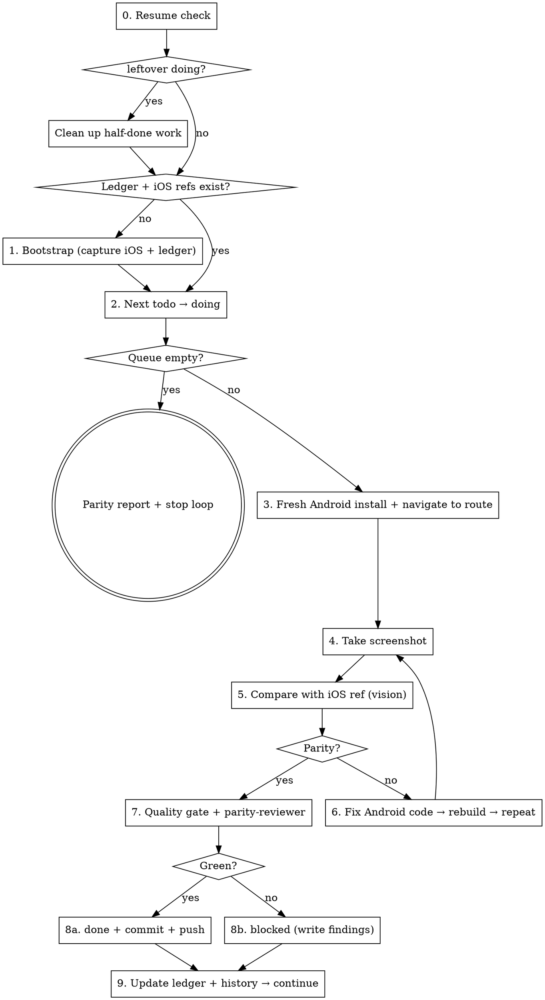

# ios-visual-parity — visual parity autopilot

## Core principle

Compare every iOS screen's golden reference `docs/port/ios-reference/<route>.png` with **a live screenshot of the running Android app**; close the gap on the Android side. The **visual twin** of `ios-port`: that skill produces features/behavior, this one verifies and polishes visuals.

**One invocation = one screen.** Every task: drive Android live → screenshot → compare with the iOS reference → fix → quality gate → commit+push → update ledger. The ledger is the single source of truth → idempotent, resume-friendly. Driven by `/loop /ios-visual-parity`.

**Comparison standard: Android should look as much like iOS as possible — every screen, every feature.** When you see a visual difference (background, icon set, layout, component look, etc.) **align it to iOS and fix it** — DON'T say "native difference, accepted". Don't ask design/calibration QUESTIONS (the decision is always "like iOS"). Exceptions: real platform constraints — SF Pro (closest font), Apple-proprietary APIs (Liquid Glass shader) — map them to the closest Android equivalent. Details and the legitimate differences list: `.claude/rules/ios-parity.md` (including any owner-decided exceptions — don't count those as parity bugs).

## When to use / not

**Use:** iOS→Android visual comparison; screen-by-screen parity; hunting missing tappable surfaces; resuming an interrupted visual round.
**Don't:** code-only refactor; a new Android feature iOS doesn't have (brainstorm first); building a wholly missing feature → `ios-port`.

## Constants

- Config: `tools/port/port.env` (`ANDROID_PKG`, `ANDROID_ACTIVITY`, `RUN_CMD`, `JAVA_HOME_OVERRIDE`).
- adb: `android_nav.sh` finds it via `$ADB`, `$ANDROID_HOME`, the default SDK paths or PATH.
- Python for `android_nav.sh` (clickables/tap): set `PY_BIN=/usr/bin/python3` if your default python3 is flaky.
- idb (iOS reference capture only, bootstrap): `idb` CLI (fb-idb, pip --user) + `idb_companion` (brew facebook/fb) — often not on PATH; booted sim UDID: `xcrun simctl list devices booted`.

## Ledger — `docs/port/visual-parity-ledger.md`

Single source of truth = the table. Columns: `| ID | Screen/Route | iOS ref | Android route | Tap-path | Status | Findings | Commit |`. Status = 7th field. Statuses: `todo · doing · done · blocked · n-a`. **At most one** `doing`.

- **Don't count by hand:** `bash tools/port/visual_parity_check.sh` → STATUS/DOING/NEXT_TODO/PARITY_PCT.
- **History ≠ ledger:** round narrative goes to `docs/port/visual-parity-history.md` (append-only, the loop doesn't read it).
- Tap-path uses **semantic selectors** — fixed pixels are FORBIDDEN. `android_nav.sh tap` resolves only `id:` / `text:` / `desc:` (e.g. `desc:Settings`, `text:Explore`). Store concrete selectors in the Tap-path column, not shorthands like `tab:X`.
- **Multi-step tap-path:** if the cell contains ` > ` (e.g. `text:Explore > text:Calendar`) that's two consecutive taps. `android_nav.sh tap` resolves ONE selector per call (it splits only on the first `:`) — a chain given to one call fails with exit 6. Split the cell on ` > `, call `android_nav.sh tap <segment>` for each in order, with `android_nav.sh idle` in between.

## Per-invocation flow (the loop body)



**0. Resume check.** `bash tools/port/visual_parity_check.sh`:
- `STATUS: RESUME` / `DOING: <id>` → the previous invocation was interrupted. If `git status` is dirty, finish if you can, otherwise clean up with `git checkout -- <paths>` and set the row back to `todo`. The repo always stays green.
- `STATUS: MULTI_DOING` (exit 3) → turn the extras into `todo`, keep one `doing`.
- `STATUS: BOOTSTRAP` → the ledger is still the shipped template → step 1.
- `STATUS: WORK` → step 2. `STATUS: QUEUE_EXHAUSTED` → the "queue empty" branch of step 2.

**1. Bootstrap (first invocation only — template ledger, or no iOS refs).** If the ledger carries the `<!-- BOOTSTRAP` comment or `docs/port/ios-reference/*.png` don't exist:
- `bash tools/port/ios_ref_capture.sh check`. No idb (exit 4) → pass the install instructions to the owner, **stop the loop** (owner-gated; don't call ScheduleWakeup).
- With idb: build + launch the iOS app on the simulator (`xcodebuild … -scheme <scheme>` → install on the sim; the iOS checkout must be on the reference branch — `bash tools/port/ios_ref.sh`). For every route in the ledger + `manifest.json`: if the manifest tapPath is a semantic label use `ios_ref_capture.sh tap-label <label>` (resolved from `describe-all`), if it's a raw coordinate use `ios_ref_capture.sh tap <x> <y>` → `ios_ref_capture.sh screenshot docs/port/ios-reference/<route>.png` → write the accessibility element list from `ios_ref_capture.sh describe` into `manifest.json`. The iOS side resolves from `describe-all` (`tap-label`), the Android side from `uiautomator dump` (`android_nav.sh tap`) — the manifest's shared selector vocabulary is normalised per platform.
- Replace the example rows and the `<!-- BOOTSTRAP` comment with the real routes from the iOS navigation structure (one row per screen). Capture what's already complete on Android too.
- Commit + push as `docs(visual-parity): iOS reference gallery + ledger bootstrap`. **End the invocation here.**

**2. Pick the next todo.** `visual_parity_check.sh` → `NEXT_TODO`. Mark that row `doing`. If `NEXT_TODO: -` / `QUEUE_EXHAUSTED` → **scan iOS sync:** `bash tools/port/ios_sync_scan.sh` (open new iOS screens as new routes; re-capture refs for changed screens). Nothing new → **re-comparison round:** turn `done` rows whose comparison predates a stricter standard (or the last iOS redesign) back into `todo` one by one and compare again. All pass → short report with `PARITY_PCT` + `BLOCKED`, **stop the loop** (don't call ScheduleWakeup).

**3. Fresh Android install + navigate to the route.**
```bash
bash tools/port/run.sh app                      # RUN_CMD (fresh install) + launch, even without code changes if git changed
bash tools/port/android_nav.sh idle
# Apply the tap-path from the ledger in order:
bash tools/port/android_nav.sh tap desc:Settings  # the real selector is verified against clickables
bash tools/port/android_nav.sh idle
# Multi-step tap-path (e.g. "text:Explore > text:Calendar"): one segment per call
bash tools/port/android_nav.sh tap text:Explore
bash tools/port/android_nav.sh idle
bash tools/port/android_nav.sh tap text:Calendar
bash tools/port/android_nav.sh idle
```
Selector doesn't match (exit 6) → look at the `clickables` output and correct the selector in the ledger.

**4. Screenshot.** `bash tools/port/android_nav.sh screenshot docs/port/android-actual/<route>.png`.

**5. Compare with the iOS ref (vision).** Open both images with **Read**: `docs/port/ios-reference/<route>.png` + `docs/port/android-actual/<route>.png`. Semantic parity judgement:
- Same content/feature/information? Is the hierarchy (hero/secondary) right?
- Does it look like iOS: background, spacing, radius, font size/weight, color, icon, component look, animation. A difference is accepted only if it's on `.claude/rules/ios-parity.md` → "Legitimate differences" (font and glass approximations, owner-decided exceptions).
- **Missing tappable surface:** compare `bash tools/port/android_nav.sh clickables` with that route's `elements` list in `manifest.json`. A meaningful interactive element on iOS that Android lacks → finding.
- **`clickables` limit (Compose):** `clickable=true` nodes often have empty text/resource-id/content-desc — the accessible strings live on non-clickable descendant nodes. So `clickables` is reliable for COUNTING tap surfaces and coordinates, not for selector DISCOVERY. To find a selector string inspect the raw `adb shell uiautomator dump` XML, or try a `text:` tap — the resolver in `android_nav.sh tap` scans ALL nodes, not just clickable ones, and taps the centre of the matching node's bounds (which lands inside the clickable parent).
- Tap each Android clickable to discover sub-screens → add new routes to the ledger as `todo` (bounded; don't add existing ones).

**6. Gap → fix.** Fix the Android code following `ios-parity.md` + all `CLAUDE.md` rules (tokens/L10n/architecture/Kotlin safety). Re-install → repeat steps 3-5 until parity or `blocked`. **A wholly missing feature** (not just visual) → open a `todo` in `docs/port/parity-ledger.md` (the code loop), mark this row `blocked` (dependency), leave the fix there.

**7. Quality gate — no commit unless everything is green:**
```bash
bash tools/port/run.sh format
bash tools/port/run.sh gate > "${TMPDIR:-/tmp}/port-gate.log" 2>&1; echo "GATE=$?"   # includes visual_parity_check.sh
```

**7.5 Second-agent review.** If you changed code, stage only your own paths (`git add -- <paths>`), then call the `parity-reviewer` subagent (Agent tool, `subagent_type: parity-reviewer`) on the staged diff: "iOS `<route>` visual parity; look for parity gaps + bugs + token/architecture violations." Narrow prompt, 2-3 items. Unresolvable must-fix → `blocked`.

**8a. done + commit + push.** Parity reached + gate green:
```bash
git add -- <paths you changed>   # no -A: a parallel session may be writing the ledger/docs
git commit -m "polish(<route>): align with iOS visual parity"   # + the session's attribution lines
git push "$PUSH_REMOTE" "HEAD:$PUSH_BRANCH"
```
Set the ledger row to `done` + commit sha. Comparison only (no code changed, already at parity) → the commit only updates the ledger/history.

**8b. blocked.** Revert partial work (`git checkout -- <files>`, the repo stays green), set the row to `blocked` + the reason in Findings.

**9. Update ledger + history → continue.** Update the ledger row; append a short round note to `visual-parity-history.md`. The loop returns to the next todo.

## Definition of Done (per screen)

- [ ] The Android screen matches the iOS reference: content, hierarchy, layout, look; every remaining difference has its "Legitimate differences" reason in Findings
- [ ] Every meaningful interactive element on iOS has a tappable counterpart on Android
- [ ] If code changed: token/L10n/architecture/Kotlin-safety rules pass, file size within the project limit
- [ ] Quality gate green
- [ ] If code changed: `parity-reviewer` approval
- [ ] `CHANGELOG.md` (if the user-facing visual change is meaningful)
- [ ] Ledger `done` + commit sha; round note in history

## Proactive iOS sync

When the queue is done, scan iOS's new commits with `ios_sync_scan.sh`; for a new user-facing screen/change open a route in the ledger (and re-capture its reference). At the end of the round, `ios_sync_scan.sh --set HEAD`.
